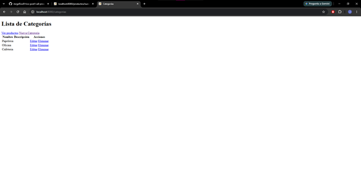
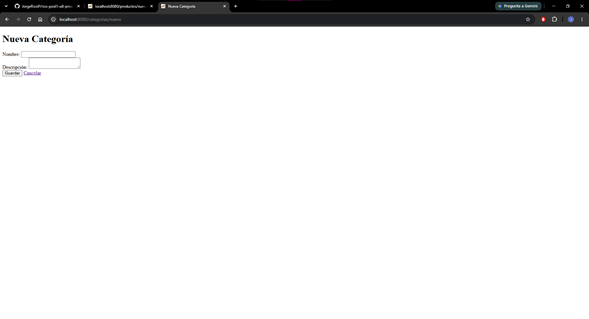
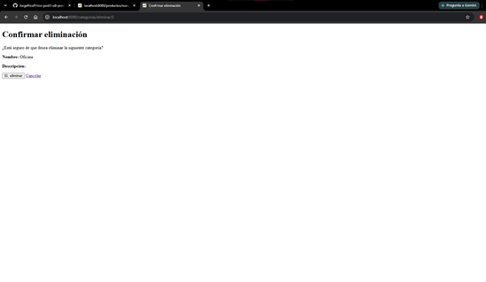

# Post-contenido — Unidad 8: Persistencia con JPA/Hibernate

## Descripción
Repositorio del laboratorio de la Unidad 8 de Programación Web —
Séptimo Semestre. Contiene un único proyecto Maven Spring Boot
(catalogo-jpa/) con un CRUD de categorías usando Spring Data JPA e
Hibernate contra MySQL, y su extensión con la entidad Producto y una
relación @ManyToOne/@OneToMany hacia Categoria.

## Parte 1 — CRUD de Categoría con JPA/Hibernate y MySQL
CategoriaController, CategoriaService y CategoriaRepository
(JpaRepository) gestionan la entidad Categoria, persistida en MySQL
mediante Hibernate. Listado, registro, edición y eliminación con
validación de campos (@NotBlank, nombre único) y plantillas Thymeleaf
(lista.html, formulario.html, confirmar-eliminar.html).

### Lista de categorías

### Formulario de nueva categoría

### Confirmación de eliminación

## Parte 2 — Relación @ManyToOne/@OneToMany con Producto
La entidad Producto agrega la relación @ManyToOne hacia Categoria
(columna categoria_id, FetchType.LAZY explícito), con el lado inverso
@OneToMany en Categoria. ProductoRepository expone
buscarPorCategoriaConPrecioMayorA, una consulta JPQL personalizada con
@Query y JOIN FETCH que retorna los productos de una categoría con
precio mayor a un valor dado en una sola sentencia SQL.

## Configuración de la base de datos
1. Crear la base de datos y el usuario en MySQL:
   `CREATE DATABASE catalogo_lab_db CHARACTER SET utf8mb4 COLLATE utf8mb4_unicode_ci;`
   `CREATE USER 'lab_user'@'localhost' IDENTIFIED BY 'lab_pass';`
   `GRANT ALL PRIVILEGES ON catalogo_lab_db.* TO 'lab_user'@'localhost';`
2. Configurar catalogo-jpa/src/main/resources/application.properties
   con la URL, usuario y contraseña de MySQL (ver Parte 1, Paso 2).

## Decisiones de diseño
- ddl-auto=update en lugar de create: conserva los datos de prueba
  entre reinicios mientras se agregaban las entidades de ambas partes.
- Nombre único en Categoria: se valida en CategoriaService antes de
  guardar, con mensaje de error legible en el formulario.
- FetchType.LAZY explícito en Producto.categoria: evita cargar la
  categoría en cada acceso a un producto; las vistas que sí necesitan
  el nombre de la categoría usan JOIN FETCH explícito en el repositorio.
- Sin cascade = REMOVE de Categoria hacia Producto: eliminar una
  categoría con productos asociados se rechaza explícitamente en el
  servicio en lugar de borrar productos en cascada.

## Cómo compilar y ejecutar
1. Clonar el repositorio: `git clone https://github.com/JorgeRicoP/rico-post1-u8-proweb.git`
2. Crear la base de datos catalogo_lab_db en MySQL (ver arriba)
3. Configurar catalogo-jpa/src/main/resources/application.properties
   con las credenciales de MySQL
4. Ejecutar `./mvnw spring-boot:run` dentro de catalogo-jpa/
5. Parte 1: acceder a http://localhost:8080/categorias
   Parte 2: acceder a http://localhost:8080/productos